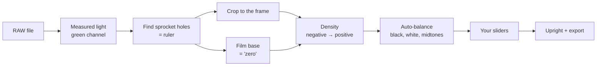

# How Film Converter works

Film Converter turns a camera photo of a black-and-white **negative** into a
finished **positive** picture, without manual editing. This page explains, in
plain words, what happens to every scan, and where the automatic steps
reach their limits.

**Contents**

1. [The big picture](#the-big-picture)
2. [Step 1 – Reading the RAW file](#step-1--reading-the-raw-file)
3. [Step 2 – Finding the frame (auto-crop)](#step-2--finding-the-frame-auto-crop)
4. [Step 3 – Measuring the film base](#step-3--measuring-the-film-base)
5. [Step 4 – Turning the negative into a positive](#step-4--turning-the-negative-into-a-positive)
6. [Step 5 – Auto-balance](#step-5--auto-balance)
7. [Step 6 – Your sliders](#step-6--your-sliders)
8. [Step 7 – Turning the picture upright](#step-7--turning-the-picture-upright)
9. [Limitations: when the automatic steps fail](#limitations-when-the-automatic-steps-fail)
10. [Tips for scans that convert well](#tips-for-scans-that-convert-well)
11. [Glossary](#glossary)

---

## The big picture



> **In one sentence:** the sprocket holes give a ruler, the ruler finds the
> frame, the clear film gives "zero", a logarithm turns the negative into a
> positive, and the tones are stretched to fill black → white.

Your original RAW files are never changed. Your edits are stored in a small
file, `film-converter.json`, in the roll's folder.

---

## Step 1 – Reading the RAW file

**What it does:** reads the camera's RAW file (for example a Nikon `.NEF`) as
pure measurements of light.

**How:**

- A camera JPEG is already brightened, contrast-boosted and colour-styled.
  The app skips all of that and reads the raw sensor data. Each pixel becomes
  a number from **0** (no light) to **1** (sensor full). Twice the light gives
  twice the number.
- It keeps only the **green channel**. B&W film has no colour, so one channel
  is enough, and green is the sharpest and least noisy on most camera
  sensors. (Advanced settings also offer red, blue or a mix.)

**Result:** a grid of numbers that says *how much light got through the film*
at each spot.

---

## Step 2 – Finding the frame (auto-crop)

**What it does:** finds the picture on the strip and crops away the film edge,
the sprocket holes and the holder.

**The trick:** sprocket holes are a built-in **ruler**. On all 35 mm film they
are exactly **4.75 mm** apart.

**How:**

| # | Step | How it's done |
|---|------|---------------|
| 1 | **Find the holes** | The holes are the brightest things in the scan: bare light shines straight through them. The app looks for very bright blobs that are hole-sized and roughly rectangular. |
| 2 | **Find the strip's direction** | Along the strip, holes are spread out evenly. Across it, they bunch into two rows (top and bottom). That shows whether the strip lies horizontally or vertically. |
| 3 | **Measure the scale** | The distance between neighbouring holes, in pixels, equals 4.75 mm. That gives *pixels per millimetre*. |
| 4 | **Top and bottom edges** | A 35 mm picture is **24 mm tall, centred between the two hole rows**. With the ruler, these edges are simple arithmetic. |
| 5 | **Left and right ends** | Between frames there is a thin strip of clear, unexposed film. The app looks along the strip for clear gaps (or for where the holder covers the film) and picks the pair that is closest to **36 mm** apart, the width of a 35 mm frame. |
| 6 | **Safety margin** | The crop is pulled **1 % inward**, so no border sneaks in. |

If any of this fails, the app shows the whole scan uncropped. You can always
draw or adjust the crop yourself (**Adjust crop**, key `C`).

---

## Step 3 – Measuring the film base

**What it does:** finds out what **"no exposure at all"** looks like on this
film.

**Why:** even clear film is not perfectly transparent. It has a slight tint
called the **film base**. In the final picture, the film base becomes the
deepest black that is possible.

**How:** the app samples the thin strips of clear film **between the
sprocket holes** (the *rebate*) at several places and takes the median. Using
the median means dust and the printed edge numbers don't throw it off.

You can also pick the film base by hand: under **Advanced**, drag a rectangle
over clear film.

---

## Step 4 – Turning the negative into a positive

**What it does:** flips dark and light, the way photographic paper would.

### Why not simply "white minus value"?

The obvious inversion, `new = 1 − old`, gives flat, muddy pictures, because
film doesn't respond to light in a straight line. Film works in **density**:

- each step of **1.0 density** blocks **ten times** more light;
- film is designed so that density rises **evenly** as the scene gets brighter
  in steps (every doubling of brightness adds about the same amount).

### The formula

```
density = log10( film base ÷ light that came through )
```

| On the negative | Light through | Density | In the real scene |
|-----------------|---------------|---------|-------------------|
| Clear film (= film base) | a lot | **0** | dark (no exposure) |
| Grey | some | medium | midtone |
| Nearly black | very little | **high** | bright |

So **density already is the positive picture**: high density means bright.
The logarithm makes the tones come out natural instead of crushed. Other
film tools, such as darktable's "negadoctor", rest on the same physics.

---

## Step 5 – Auto-balance

**What it does:** makes each picture use the full range from black to white,
with natural-looking midtones.

**Where it looks:** only at the **inner part of the cropped frame**. An 8 %
margin around the edges is ignored, so any leftover border can't fool it.

### 5a – Black and white points ("levels")

The app sorts all pixels from darkest to brightest:

- the pixel **0.2 %** of the way up becomes **pure black**;
- the pixel **99.8 %** of the way up becomes **pure white**;
- everything in between is stretched evenly.

*Why not the very darkest and brightest pixels?* A single dust speck or
scratch would then decide the whole picture. Skipping the extreme 0.2 % on
each end ignores such outliers.

### 5b – Midtones (gamma)

The app finds the **middle pixel** (the *median*: half the picture is darker,
half is brighter). It bends the tone curve so that this pixel lands at **45 %
brightness**, a little below middle grey, which looks natural to the eye.

- Dark scenes are brightened, bright scenes are toned down.
- Pure black and pure white don't move.
- The bend is limited, so a night shot is not turned into daylight.

### Preview = export

These automatic values are computed once, on the fast preview, and saved.
The full-resolution export reuses exactly the same numbers, so **the
exported file looks like what you saw on screen.**

---

## Step 6 – Your sliders

All sliders work in "positive" directions: **right = brighter or stronger**.

| Slider | What it does |
|--------|--------------|
| **Exposure** | Brightens or darkens the whole picture, in camera "stops" (+1 = twice the light). |
| **Contrast** | Right: an **S-curve** (darks darker, brights brighter, middle stays). Left: flatter. |
| **Highlights** | Lifts or lowers only the bright parts. |
| **Shadows** | Lifts or lowers only the dark parts. |
| **Whites** | Moves the white point from step 5a. |
| **Blacks** | Moves the black point from step 5a (right lifts the shadows). |
| **Sharpening** | Light "capture sharpening" on export (full resolution only). |

---

## Step 7 – Turning the picture upright

Depending on how the strip went into the holder, frames can come out upside
down.

**How:** the app compares the **top third** of the picture with the **bottom
third**. In most photos the top is brighter (sky, ceilings, windows). If the
bottom is brighter, the frame is rotated by 180°.

On a first test roll this was right on 33 of 35 frames. You can rotate
(`[` `]`) and flip (`H` `V`) any frame by hand; a manual rotation always wins.

---

## Limitations: when the automatic steps fail

The automatic steps rely on assumptions about the scan. When an assumption
doesn't hold, the app does not crash. It falls back to something simpler
(usually: no auto-crop), and you correct the frame by hand.

### Auto-crop (step 2)

| Situation | Why it fails | What happens / what to do |
|-----------|--------------|---------------------------|
| **No sprocket holes in the scan** (holes cut off or covered, or a holder that hides them) | No holes means **no ruler**: no scale, no frame position. | No auto-crop; the whole scan is shown. Crop by hand. |
| **Film without perforations: 120 / medium format** (6×6, 6×7, 6×4.5…) | Same: there are no holes at all. | Crop by hand. (Support for 120 is planned.) |
| **Fewer than 3 holes detected**, or no two neighbouring holes in a row | Too few to tell the strip's direction or to measure the hole spacing. | No auto-crop. |
| **Holes not brighter than everything else** (e.g. a dim or blocked light under the holes, or bare light visible elsewhere) | The holes are found as the brightest hole-sized blobs. | Holes may be missed, or other bright spots taken for holes. |
| **Very different magnification** (strip very small in the picture, or zoomed in so far that holes are huge) | Hole-sized means roughly 1–8 % of the image's long side. | Holes outside that range are ignored. |
| **Not 24 × 36 mm frames**: half-frame, panoramic (XPan) cameras | The frame size is hard-coded to 24 × 36 mm. | The crop will be wrong; crop by hand. |
| **Several frames in one shot** | The app assumes **one frame per shot** and takes the frame nearest the middle. | Only one frame is cropped. |
| **Strip noticeably tilted** in the scan | The crop is a straight rectangle; it can't rotate by a few degrees. | Part of the border or the picture edge may be included. Straighten the strip on the rig. |
| **Very dark scene areas touching the frame edge** | On the negative, these are almost clear, like the gap between frames. | Usually still right (the 36 mm rule filters most cases), but an end can be misplaced. |

### Film base (step 3)

| Situation | What happens |
|-----------|--------------|
| **No clear rebate between holes visible** | The app falls back to "the brightest part of the scan that isn't bare light". If bare light is visible outside the holes (no holder mask), it can be picked by mistake. Pick the base by hand under Advanced. |
| **The film base differs a little from frame to frame** (seen: 0.18–0.29 on one roll, same exposure) | With per-frame auto-balance this cancels out, so it doesn't matter. It would matter for a future "same levels for the whole roll" mode. |

### Negative → positive (step 4)

| Situation | What happens |
|-----------|--------------|
| **Colour negatives (C-41, orange mask)** | Not supported yet. The B&W method uses one channel and doesn't remove the orange mask, so colours would be wrong. Planned for a later version. |
| **Clipped (over-exposed) scan**: the clear film reached the sensor's maximum | Clear film is the **shadows** of the photo. Clipped pixels have no detail left, so shadow detail is lost. |
| **Under-exposed scan** | Dense film areas (the **highlights**) get very little light, so bright skies come out noisy. |

### Auto-balance (step 5)

| Situation | What happens |
|-----------|--------------|
| **Scenes that should not fill black → white** (fog, haze, a dark night scene, a snowy field) | Every frame is stretched to full black and full white, so fog gets more contrast than it had and a night scene is brightened (within limits). Use the sliders to restore the mood. |
| **A series of similar frames** | Each frame is balanced on its own, so neighbouring frames of the same scene can differ slightly in brightness. Use **Copy / Paste** or **Apply to all** for a consistent look. |
| **Wrong crop** | Balance looks at the cropped area. If the crop includes holder or rebate, the levels are thrown off. Fix the crop first. |

### Upright (step 7)

| Situation | What happens |
|-----------|--------------|
| **Pictures where the bottom is brighter**: water, reflections, beaches, snow, dark sky over a lit street | The guess is wrong; rotate by hand. |
| **Portrait (vertical) frames** | Only 0° and 180° are detected, not 90°. Rotate by hand. |
| **Mirrored scans** (film shot from the emulsion side) | Not detected. Use **Flip horizontal** (`H`). |

### Things the app doesn't do

- **Uneven light source:** if the light is darker toward the corners, the
  corners come out slightly brighter in the positive. There is no
  flat-field correction yet (the crop step does allow for it).
- **Dust and scratches** are not removed.
- **Focus:** software can't recover a soft scan. Sharpening helps a little,
  but focus and a steady camera matter more.
- **Camera support:** any RAW format supported by LibRaw should work (Nikon,
  Canon, Sony, Fujifilm, Olympus, Panasonic, Pentax, DNG). It was developed
  and tested with a Nikon D7000.

---

## Tips for scans that convert well

1. **One frame per shot**, with a little of the strip around it: some clear
   film between frames, and **both rows of sprocket holes visible**.
2. **Mask the light around the strip** (a dark holder), so bare light shows
   only through the holes.
3. **Keep the strip straight** in the frame.
4. **Expose so the clear film is bright but not clipped.** All frames of a
   roll with the same manual settings.
5. **Focus carefully** and avoid vibration (a delay or remote release).
6. Open the whole roll folder at once. Check the auto-crops, rotate the odd
   frame, then export.

---

## Glossary

| Term | Meaning |
|------|---------|
| **RAW file** | The camera's unprocessed sensor data (`.NEF` on Nikon). |
| **Negative** | Film after developing: light and dark are reversed. |
| **Positive** | The normal picture, light and dark as in the scene. |
| **Film base** | The film material itself; its tint is visible in clear, unexposed areas. |
| **Rebate** | The film edge outside the picture, along the sprocket holes. |
| **Sprocket holes / perforations** | The holes along both edges of 35 mm film, 4.75 mm apart. |
| **Density** | How much the film blocks light, on a log scale: +1 means ten times less light gets through. |
| **Percentile** | The value below which a given share of pixels lies (the 50th percentile is the median). |
| **Gamma** | A curve that brightens or darkens the midtones without moving black and white. |
| **Stop (EV)** | A doubling (or halving) of light. |
